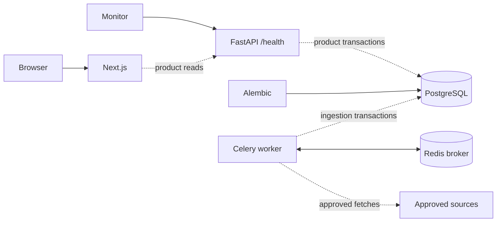
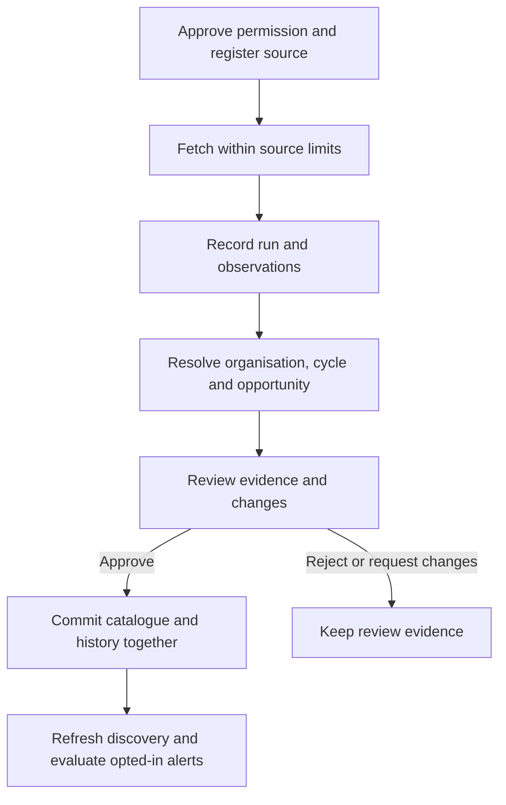

# Architecture

Recruitment Waala is a modular monorepo with one domain backend and one shared
PostgreSQL database. The Celery process handles eventual asynchronous work alongside
the API. Redis is the queue broker. Next.js owns presentation and calls the API
over HTTP as product routes are introduced.

Solid arrows show Phase 0 interfaces; the worker is started explicitly. Dotted
arrows show planned integrations. Web health checks rendering and API health checks
process liveness. Add dependency-aware readiness before routing production traffic.

| Location | Ownership |
| --- | --- |
| `apps/web` | App Router, TypeScript, Tailwind v4, shadcn/ui configuration |
| `services/api` | FastAPI, SQLAlchemy metadata, migrations and API tests |
| `workers/ingestion` | Celery entry point and future ingestion orchestration |
| `packages/contracts` | Shared API specifications and future generated clients |
| `infra` | Infrastructure guidance and future deployment definitions |
| `docs` | Product scope, schemas, API and operations policy |

## Domain boundaries

The catalogue owns public records and lifecycle. Government recruitment and exam
artifacts share a cycle with explicit parent links. Corporate roles and internships
use the same catalogue with category validation. Search initially queries published
PostgreSQL projections with indexed filters, then evaluates full-text indexes from
observed query plans. Accounts own profiles and saves, and alerts own subscriptions
and future delivery state. Ingestion owns source observations, while moderation owns
approval decisions and transactional catalogue updates.

The ingestion diagram describes the planned workflow. Lock or compare the current
record inside the publishing transaction. Use durable operation keys and an outbox
when alert deliveries or queue publishes must follow database writes. Redis messages
can be redelivered, so workers need idempotency and bounded retries.

Use private database and broker networking in production, scoped service identities,
TLS, externally managed secrets and explicit origin policy. Separate runtime,
migration and operator privileges. Disable verbose errors and redact credentials and
personal data from logs. Plan backups and restore drills, structured logs with
request/run IDs, queue lag metrics and stale-source alerts before launch.
