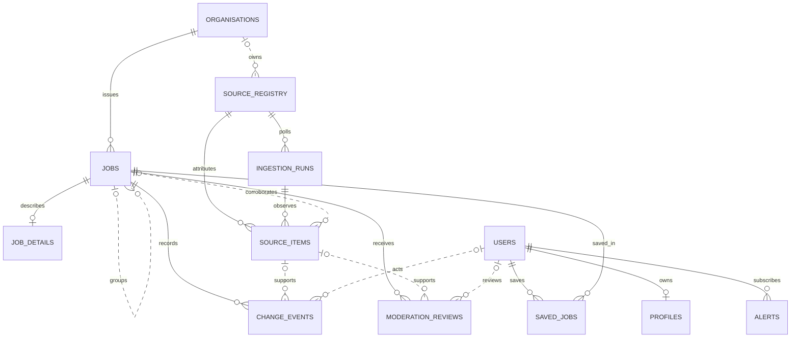

# Database schema

The initial Alembic revision creates an empty PostgreSQL schema. SQLAlchemy
metadata is the schema model for future migrations. UUIDs identify rows and
timestamps use time zone-aware PostgreSQL types. Date-only or ambiguous source
values belong in evidence until they can be represented without inventing a cutoff.

| Table | Main fields and invariants |
| --- | --- |
| organisations | Unique slug, name and official URL |
| jobs | Issuing organisation, cycle key, category and opportunity key are unique together. Parent links enforce the same issuer and cycle. Status tracks draft, published, expired and withdrawn. Publication requires a date and official URL. |
| job_details | One row per job. Description, location, official apply link, application window and JSONB category fields |
| source_registry | Source slug, optional owning organisation, adapter kind, endpoint, permission evidence, approval time and disabled-by-default flag |
| ingestion_runs | Per-source unique run key, start and finish timestamps and outcome |
| source_items | Each observation references a run of the same source. Run, external key and SHA-256 prevent duplicate observations within a run. Retain source URL, observed time and optional restricted snapshot reference. |
| change_events | Append material changes with before and after values and optional source evidence and actor |
| moderation_reviews | Append disposition and reason with optional evidence and reviewer |
| users | Unique external identity issuer and subject, with member, moderator or admin role |
| profiles | Optional profile per user with display name and locale |
| saved_jobs | Composite user and job key prevents duplicate saves |
| alerts | User, versioned filter object by application convention, cadence and disabled-by-default flag |

## Identity, publication and history

Use authoritative cycle identifiers with their issuing scope, year or round when
needed. External keys are adapter-scoped and can be reused upstream. Their
observations are retained separately from canonical identity. Titles, URLs, hashes
and normalized descriptions can suggest review candidates. Require corroborating
cycle evidence before merging. When identity is ambiguous, hold the observation
for review. Opportunity keys distinguish notices, roles and exam stages in a cycle.
Avoid cascading deletion of catalogue evidence. User deletion cascades private
profiles, saves and alerts and clears actor references in audit rows.

Promote stable filter fields to typed columns when they become query inputs. Validate
JSONB category payloads at the application boundary before writing. Suggested fields
are notification number, year, round and vacancy criteria for government roles;
stage, exam date and document URL for exam artifacts; requisition ID, employment
type and workplace mode for corporate roles; duration and stipend for internships;
topic and issue date for career updates.

Future publication code must validate official URLs and category schemas, prevent
parent cycles, ensure evidence belongs to the reviewed opportunity, keep
`updated_at` current and write decisions and history atomically. Public history will
use a redacted projection. Current discovery must filter both status and expiry so
that a delayed expiry task cannot expose an opportunity as open. Discovery and expiry
indexes support initial PostgreSQL queries. Published evidence retention, account
deletion and secure snapshot storage need operational policies before launch.
