# Ingestion architecture

```mermaid
flowchart LR
  Beat --> Dispatch --> Poll
  Poll --> Lock["Approval check and advisory lock"]
  Lock --> Retrieve["Scoped, rate-limited HTTPS GET"]
  Retrieve --> Parse["Adapter validation and normalisation"]
  Parse --> Store["Observation, draft and review candidate"]
  Store --> Review["Protected operator review"]
  Review --> Publish["Phase 2 publication / reviewed correction"]
  Publish --> Public["FastAPI public read / Next.js"]
```

Phase 2 already owns lifecycle, source observations, public visibility and
editorial transitions. Phase 3 adds a polling extension and review candidates
instead of a second catalogue. The previous one-host link policy is retained
for manual Phase 2 sources. Managed sources use separate recorded notice
and application path scopes because ATS retrieval and public links can have
different origins.

Adapters implement discovery, retrieval, parsing, normalisation and validation.
The custom JSON input is an array whose entries contain `external_id`,
`draft` matching the OpenAPI Draft schema, optional `closed`, and optional
short string `metadata`. JSON can represent every catalogue category. A
snapshot source can report absences only when explicitly configured for
coverage and the response has no invalid or duplicate identities. Greenhouse
also checks the declared count. Lever views are not treated as complete
snapshots in this phase.

Government HTML reads links only within the configured notice scope. Direct
PDF extraction runs in a bounded child process. Unreadable or ambiguous
notices create failed-validation candidates, not public records. Label-based
PDF extraction may supply a title, reference, eligibility, age, fees and
vacancy count. Issuer text, instructions and deadline text remain review
metadata. The parser leaves dates null when it cannot establish a cutoff.
Retain a bounded text excerpt only if the approval allows it. Endpoint
configuration should target recruitment notices, never applicant records,
documents with individual scores, or restricted examination material.

Source identity combines a provider external ID and the recruitment cycle.
PostgreSQL enforces canonical issuer, cycle, category and opportunity key.
ATS boards derive identity from board plus posting ID. Government HTML/PDF
requires a configured cycle and a scoped notice URL. Issuers with stable
reference and post codes should use the structured feed to supply those
identities. Alternate URLs without a shared canonical key require manual
consolidation. Titles alone never merge records.

Each detected change is staged against its prior structured observation.
An unchanged payload produces no new event. Existing approved facts remain
in the public projection until an operator accepts a correction. A missing
or explicitly closed posting only proposes withdrawal. An operator can
withdraw a published record using evidence from its current published source.
The default publication policy is manual. An approved Greenhouse or Lever
source can opt into `release_reviewed_ats`. Beat can then publish a corporate
draft after an operator has accepted its latest valid observation. Release
requires current approval, an approved application URL, an existing editorial
verification timestamp and a non-expired record. Government notices and
corrections remain manually reviewed. Parsing and HTTP success do not set
verification timestamps.

The Greenhouse adapter reads the board list endpoint. Per-posting
pay-transparency lookups are outside this configuration. Lever reads the
explicit salary range when present. Neither adapter infers experience,
skills or working arrangements from marketing copy.
